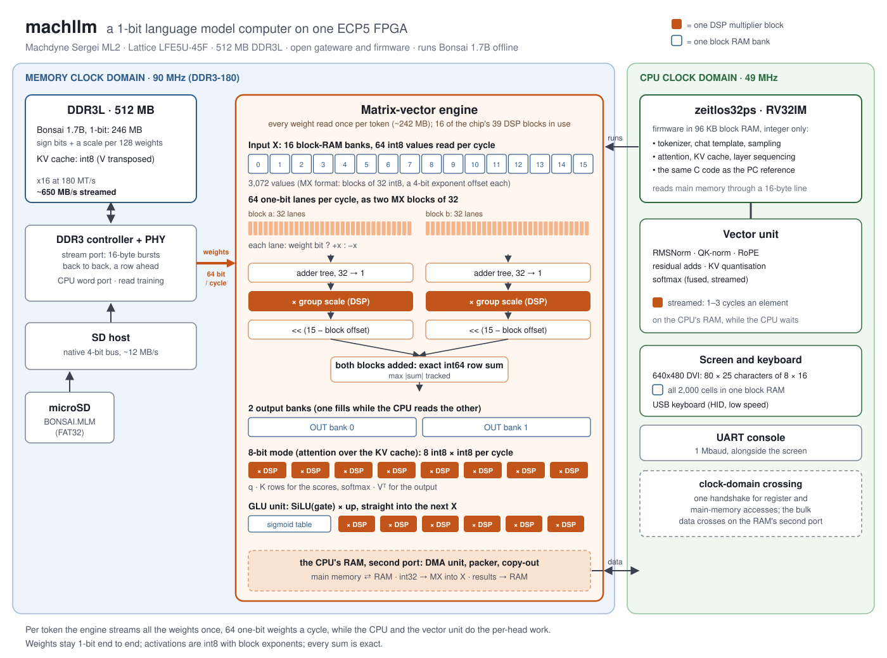

# machllm

**A language model computer on an FPGA.** machllm is a system-on-chip
for Machdyne's ECP5 boards that does one thing: run a language model,
entirely in our own open gateware and firmware, offline.



- **Board:** Sergei ML2 (LFE5U-45F, 512 MB DDR3L); Mozart ML2, the
  same chip and memory, is planned.
- **Model:** [Bonsai 1.7B](https://huggingface.co/prism-ml/Bonsai-1.7B-gguf)
  by PrismML: 1-bit weights in the Qwen3-1.7B layout, converted from its
  GGUF (`Q1_0`) to a 246 MB `.mlm` image. The engine is built for 1-bit
  weights; 4- and 8-bit weight models are no longer supported (8-bit
  stays for the attention cache).
- **Interface:** serial console (1,000,000 8N1). A text terminal and USB
  keyboard come later; their space is reserved.

## How it works

A generated token reads every weight once: about 242 MB for Bonsai.
The **engine** streams them from DDR3 and multiplies 64 one-bit weights
per cycle against an int8 input in blocks of 32 with shared exponents
(MX format), keeping exact 64-bit sums. A **GLU unit** next to it turns
the FFN's gate and up outputs into the next input without the CPU.

The **CPU** (Zeitlos's zeitlos32ps, RV32IM) runs the model in integer
arithmetic: the same C code as the PC reference (`ref/mlm_run`). A
**vector unit** beside it does the elementwise work (norms, RoPE,
residuals, input packing, KV-cache quantisation). The memory side runs
at 90 MHz (DDR3-180), the CPU at 49 MHz; bulk data crosses between them
in dual-clock RAMs.

## Status

Measured on a Sergei ML2:

| | |
|---|---|
| DDR3 | trained at 180 MT/s; the engine streams 648 MB/s |
| loading Bonsai from SD | 246 MB in ~21 s (4-bit bus, 24 MHz) |
| engine self-test, `:e` | the engine's results equal the CPU's |
| generating (75 MHz build) | coherent answers, **1.24 tokens/s** over a 256-token answer |
| 90 MHz build | meets timing; on the board a prompt token takes 0.54 s |

The firmware and the PC reference compute the same integer arithmetic,
and every simulation (`docs/testing.md`) is bit-exact against it.

Known limits:

- Context of 512 positions per conversation (`:reset` starts over);
  answers stop at the model's end token or after `:n` tokens (256).
- Attention grows with the context: at position ~280 a token takes
  ~0.8 s instead of ~0.7 s.
- Prompts cost one weight pass per token (no batched prefill yet).
- The firmware does not yet refuse a model image with 4- or 8-bit
  weights (an old one loads and produces nonsense).
- Builds for Sergei ML2 only; Mozart ML2 pins are not done. At 90 MHz
  only some placement seeds meet timing.

## Quick start

```
git clone --recursive <this repository>
make ref                                        # the PC reference engine
python3 tools/mlm_convert.py gguf Bonsai-1.7B-Q1_0.gguf build/models/bonsai.mlm
./ref/mlm_run build/models/bonsai.mlm -i "The capital of France is" -n 16 -t 0
tools/mkcard.sh /media/you/CARD build/models/bonsai.mlm     # FAT32 -> BONSAI.MLM
openFPGALoader -c dirtyJtag build/sergei_ml2_mem90/machllm.bit
```

The GGUF is the file Ollama downloads for
`hf.co/prism-ml/Bonsai-1.7B-gguf:Q1_0`. Bitstreams come in the release
zips; building one is in [docs/usage.md](docs/usage.md) (synthesis and
place and route take about 30 minutes; a new firmware goes into a
placed design in seconds with `make fwbit`).

## Documents

| | |
|---|---|
| [docs/usage.md](docs/usage.md) | build, flash, the card, the console |
| [docs/models.md](docs/models.md) | converting and checking models |
| [docs/architecture.md](docs/architecture.md) | the SOC, memory map, clocks, resources |
| [docs/format.md](docs/format.md) | the `.mlm` image |
| [docs/arithmetic.md](docs/arithmetic.md) | the integer arithmetic (the specification) |
| [docs/engine.md](docs/engine.md) | the matrix-vector engine and GLU unit |
| [docs/vu.md](docs/vu.md) | the vector unit |
| [docs/memory.md](docs/memory.md) | the DDR3 streaming controller |
| [docs/sd.md](docs/sd.md) | the native SD host and FAT loader |
| [docs/testing.md](docs/testing.md) | the simulations and what each proves |

## Licence

Same as Zeitlos: see [LICENSE.md](LICENSE.md). Zeitlos is a pinned
submodule (`ext/zeitlos`); files forked from it say so in their header.
Model weights keep their own licences (Bonsai 1.7B: Apache-2.0).
