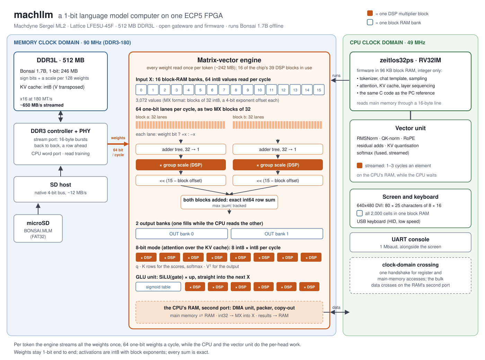

# Architecture



```
 CLK_48 -> PLL: DDR3 edge clock 180 MHz, memory side 90 MHz, CPU 49.09 MHz

 CPU side (49 MHz)                         memory side (90 MHz)
 zeitlos32ps --+-- RAM 96 KB ====== second port ======+-- ENGINE: copy-out, packer
 (RV32IM)      |   (vector unit)                      +-- DMA unit: stream reads,
               +-- SYSCTL                             |   block writes, byte stores
               +-- UART (1M 8N1)                      |
               +-- vector unit                        +-- ENGINE + GLU unit -- sq/sd: stream ----+
               +-- screen + keyboard                  +-- SD host (4-bit) --- wq: block writes --+--> mlm_ddr3
               |   (25.2 / 126 / 12 MHz)              +-- DDR3 registers (training)              |   (controller
               +-- read line (16 B) <== handshake ==> +-- MAIN 512 MB (CPU word path) -----------+    + PHY)
```

The memory side (DDR3 controller and PHY, engine, GLU unit, SD host)
runs on the DDR3 system clock; the CPU, its RAM, the vector unit, UART
and SYSCTL on a second PLL output. Register and main-memory accesses
cross one at a time through a handshake in `rtl/mlm_soc.v`; the bulk
data crosses through the CPU RAM's second port, which runs on the
memory clock: the engine's copy-out writes results straight into the
RAM, its packer reads the int32 vector it MX-packs into the engine's
input from the RAM, and the DMA unit (`rtl/mlm_dma.v`) streams main
memory into the RAM (cache scales, norm weights, RoPE rows, layer
descriptors) and writes the KV cache from it. The CPU only starts them
and waits. Builds: `make MEM_MHZ=90` (DDR3 at 180, CPU 49.09: the fast
build), `make MEM_MHZ=75` (DDR3 at 150, CPU 50), plain `make` (one
domain, 48 MHz). See [usage.md](usage.md).

## Memory map (`rtl/mlm_soc.v`)

| Address | | |
|---|---|---|
| 0x0000_0000 | RAM | 96 KB block RAM, initialised with the firmware |
| 0x4000_0000 | MAIN | 512 MB DDR3; the model image at offset 0 |
| 0x7000_0000 | SYSCTL | +0 LED, +4 ID "MLLM", +8 build, +12 bit 0: the CPU's read line on (`:k`) |
| 0x7000_0700 | DDR3 | STATUS, TUNE, CTRL (Zeitlos's; CTRL[5:4] = stream gap) |
| 0x7100_0000 | UART | +0 data, +4 status, +8 divisor |
| 0x7200_0000 | SD | see [sd.md](sd.md) |
| 0x7300_0000 | VU | vector unit, see [vu.md](vu.md) |
| 0x7600_0000 | UI | the screen's 2,000 cells, ID "UI01", ROWBG, the keyboard (`rtl/mlm_ui.v`; `UI=1`) |
| 0x8000_0000 | ENGINE | see [engine.md](engine.md) |
| 0x8100_0000 | DMA | main memory <-> RAM, see [memory.md](memory.md) |

The CPU's port takes a request every cycle for the RAM (answer the
next cycle), and for main-memory reads that
fall in the last line read (16 bytes, kept on the CPU side when
SYSCTL+12 is set); it holds the port for every other target until it
answers (~20 CPU cycles across the crossing).

## Who does what

| Work | Where |
|---|---|
| matrix x vector: every weight (1-bit), attention scores and attention x V (8-bit cache) | engine |
| SwiGLU (SiLU x up, packed into the engine's next input) | engine's GLU unit |
| packing vectors into the engine's input (MX format), results into the RAM | engine (packer, copy-out) |
| RMSNorm, QK-norm, RoPE, residual adds, KV-cache quantisation, softmax | vector unit ([vu.md](vu.md)) |
| main memory <-> RAM: scales, norm weights, KV-cache writes | DMA unit |
| sequencing, scalar maths (reciprocals, square roots), top-k and sampling | CPU (`fw/common/mlm_model.c`) |
| tokenizer, chat template, console | CPU |
| loading the model | SD host, straight into DDR3 |

## Resources (Sergei ML2, LFE5U-45F)

`make MEM_MHZ=90` with the screen and keyboard (the default, `UI=1`):

| | Used | Of | |
|---|---|---|---|
| LUT4 (TRELLIS_COMB) | 34,589 | 43,848 | 78% |
| flip-flops (TRELLIS_FF) | 16,807 | 43,848 | 38% |
| block RAM (DP16KD) | 100 | 108 | 92% |
| multipliers (MULT18X18D) | 39 | 72 | 54% |

Timing (seed 6): memory side 90.7 MHz (90.0 needed), CPU 52.9 (49.1),
pixel clock 55.7 (25.2).

Block RAM: firmware RAM 48 (both of its ports used: the CPU's and the
memory side's), the engine's output memory, input memory (16 narrow
banks), the sigmoid table, the controller and SD buffers. Block RAM is the scarce resource
now. The screen and keyboard (`UI=1`) take one: the 80 x 25 cells (9
bits each: a 7-bit character and a 2-bit colour) fill one 2048 x 9
block RAM; the 8x16 font and the USB core's ROM are in logic. They add
~2,000 LUTs and two clocks (a second PLL for 25.2 / 126 MHz; 12 MHz for
USB from the first), and nothing to the memory side.

The multipliers (`rtl/mlm_mul18s.v`, `rtl/mlm_mul16r.v`) are plain
Verilog that Yosys maps to DSP blocks without their own registers;
operands and products are registered in the fabric. Instantiating
MULT18X18D with the block's registers gave all-zero products on the
board (bonsai-v1 to v4) while every simulation passed.

## Files

| | |
|---|---|
| `rtl/mlm_soc.v` | the system |
| `rtl/mlm_engine.v` | matrix-vector engine and GLU unit |
| `rtl/mlm_vu.v` | vector unit |
| `rtl/mlm_ui.v`, `rtl/mlm_font8x16.hex`, `rtl/mlm_hid_rom.v`, `rtl/mem/mlm_vpll.v` | screen (text mode, TMDS) and keyboard (nand2mario's usb_hid_host from Zeitlos's `rtl/ext`) |
| `rtl/mlm_mul18s.v`, `rtl/mlm_mul16r.v` | DSP multipliers (signed 18x18, unsigned 16x16) |
| `rtl/mem/mlm_ddr3.v`, `mlm_ddr3_ctrl.v` | DDR3 (forked from Zeitlos) |
| `rtl/mem/mlm_ddr3_clk.v`, `mlm_pll.v` | DDR3 clocking (Zeitlos's, with the clock as a parameter) |
| `rtl/sd/mlm_sd.v` | SD host |
| `rtl/mlm_uart.v` | serial port |
| `boards/sergei_ml2/` | top level and pin file |
| `ext/zeitlos` | Zeitlos (pinned): CPU, DDR3 PHY and clocking |
| `fw/` | firmware; `fw/common/` is shared with `ref/` and the simulations |
| `ref/` | PC reference engine and comparison tools |
| `tools/` | converter (GGUF, llama2.c, HF), GGUF reader and float reference, synthetic models, card helper, timing and ecpbram helpers |
| `sim/` | simulations, see [testing.md](testing.md) |
